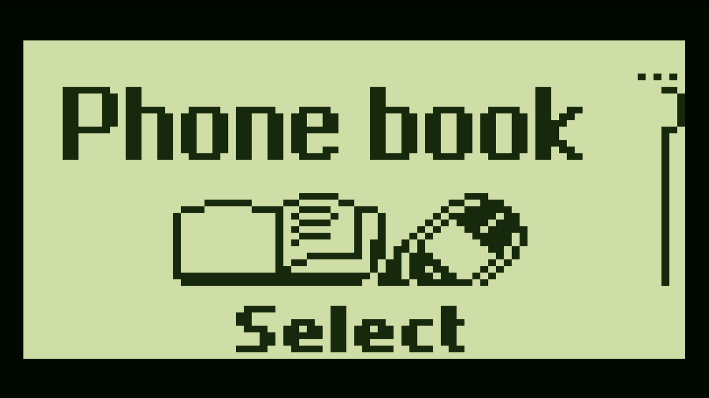

# Open Nokia 3310

Original Nokia 3310 firmware on the **Sipeed Tang Nano 20K FPGA**.
Board interfaces follow [Open Pocket GBC](https://github.com/LakoMoor/open-pocket-gbc).

[Website](https://lakomoor.github.io/OpenNokia3310/) · [Verification log](docs/STATUS.md) · [Credits](docs/PROVENANCE.md) · [Русская документация](README.ru.md)



**Work in progress.** Original v5.79 and v6.39 firmware have booted on the board.
Phonebook, Settings, language selection and applying Russian were verified by
actual HDMI capture. Repeated boots remain unreliable. Physical DS2 button presses now reach the Nokia matrix in an I/O diagnostic
build; full phone menu verification is still in progress. A GSM radio, cellular calls
and SMS over a mobile network are not implemented.

## Hardware

- Tang Nano 20K: Gowin GW2AR-18, embedded SDRAM and W25Q64 SPI flash.
- HDMI: 720 × 480, with the 84 × 48 phone LCD scaled 8× to 672 × 384.
- ST7735S 128 × 128: shared framebuffer, centered at offset 22/40.
- DualShock 2 through the Sipeed adapter used by Open Pocket GBC.
- USB-C JTAG programming and 115200-baud UART diagnostics/control.

HDMI is verified. The ST7735S is connected, but its displayed output has not yet
been confirmed. These are **FPGA package pin numbers**, not connector positions.
See the [complete CST](rtl/board/tangnano20k.cst).

| Interface | Package pins |
| --- | --- |
| DualShock | CLK 17, CS 18, MISO 19, MOSI 20 |
| LCD | SCL 73, SDA 74, RESET 71, DC 72, CS 53, BL 52 |
| SPI flash | CS 60, CLK 59, MOSI 61, MISO 62 |

## Architecture

```text
SPI flash → boot DMA → SDRAM ↔ ARM7TDMI-S ↔ MAD2 / CCONT / NOR / DSP / SIM
                                                   ↓
                                              PCD8544 LCD
                                                   ↓
                                             HDMI + ST7735S
DualShock 2 / USB UART → Nokia key matrix
```

The firmware executes its own ARM/Thumb code and renders its own menus, fonts
and screens. Models implement the surrounding devices. The DSP ROM6 service is
a subset of boot/security transport, not a complete C54x. The virtual SIM is a
synthetic test card without a subscriber Ki. NOR writes currently modify only
the SDRAM copy. Settings and language changes are lost on restart. Games and
sustained operation have not yet been verified.

## Controls

The mapping passes RTL tests. Physical directions, Circle → Menu and Cross → C
have been captured through UART in the I/O qualification target. Full phone
menu operation with the revised driver is still being checked.

| DualShock | Nokia | While holding L1 |
| --- | --- | --- |
| D-pad up / down | Up / down | 2 / 8 |
| D-pad left / right | 4 / 6 | 4 / 6 |
| Circle / Cross | Menu / C | 3 / 5 |
| Triangle / Square | 2 / 8 | 1 / 0 |
| L2 / R2 | — | 7 / 9 |
| Select / Start | — / Power | * / # |

Button levels reach the original key matrix; firmware handles repeats.
Invalid/disconnected controller responses release all keys. Menu, C, digits
and directions can also be sent through UART during development.

## Build

Requires Python 3 and OSS CAD Suite with yosys-slang, nextpnr-himbaechel and
Apicula. Simulation also requires Verilator and g++ with C++20 support.
Scripts currently target Windows; the default tool path is
`E:/tools/oss-cad-suite`. Override it with `--tools` or `TOOLS`.
Install `pyserial` for optional UART tools.

```powershell
git clone https://github.com/LakoMoor/OpenNokia3310
cd OpenNokia3310
python tools/test.py
python tools/build.py nokia_top
```

| Target | Purpose |
| --- | --- |
| `nokia_top` | Full integration; LUT4-only mapping by default |
| `nokia_io_top` | HDMI/LCD/controller/UART qualification without a CPU |
| `nokia_core --synth-only` | ARM/device models with an external memory bus |
| `arm7_probe --synth-only` | CPU resource estimate |

Builds fail on synthesis, placement or timing errors. HDMI uses 27 MHz pixels
and a 135 MHz serializer; ARM/SDRAM run at 16.875 MHz.

## Firmware and loading

Proprietary Nokia firmware is not included. Supply a legally obtained raw dump.
See [firmware preparation](firmware/README.md) for formats and hashes.
v6.39 PPM W contains English, Estonian, Russian and German. Select
**Menu → Settings (6) → Phone settings (2) → Language (1)** on the phone.

```powershell
python tools/prepare_firmware.py path/to/full-2MiB-dump.fls
# A raw MCU+PPM dump needs an explicit 192 KiB EEPROM/PM partition:
python tools/prepare_firmware.py path/to/mcu-ppm.fls --eeprom path/to/eeprom.bin
```

Back up flash before replacing ROM data: another project may use this region.
The 2 MiB phone image is stored at SPI offset 0x200000 and mapped to phone
addresses 0x200000–0x3FFFFF. These commands load FPGA configuration into SRAM;
the FPGA bitstream is not permanently installed.

```powershell
openFPGALoader -b tangnano20k --dump-flash -o 0x200000 --file-size 2097152 backup.bin
openFPGALoader -b tangnano20k -f --verify -o 0x200000 --file-type bin firmware/nokia3310.bin
openFPGALoader -b tangnano20k build/nokia_top_lut4/nokia_top.fs
```

## Development tools

```powershell
python tools/read_pad.py COM6 --seconds 10 # nokia_io_top only
python tools/key_remote.py COM6 menu
python tools/key_remote.py COM6 c
python tools/read_status.py COM6 --seconds 5
python tools/capture_hdmi.py --output build/hdmi-capture.png
python tools/trace_firmware.py firmware/nokia3310.bin --cycles 10000000
```

Use your actual UART port. HDMI capture needs an attached DirectShow capture
device (default `USB3.0 UHD`) and FFmpeg. Simulation frames are not hardware
captures. N3 telemetry reports boot/memory/LCD state; the newest diagnostic
build reports the first SPI ROM word in the address field when no LCD writes
have occurred.

## Verification and licensing

RTL tests cover the LCD, key matrix, DS2 transport, UART, video, MAD2, NOR,
SPI DMA, memory bridge, CDC FIFO, DSP service and SIM. A FIQ regression checks
a [local CPU interrupt fix](third_party/arm7tdmi-sv/LOCAL_CHANGES.md).
Passing tests does not establish full phone compatibility.

Integration: GPL-3.0-or-later. Third-party licenses and attribution are retained
in `third_party/` and [PROVENANCE.md](docs/PROVENANCE.md). This is an independent
project, not affiliated with Nokia or Sipeed.
