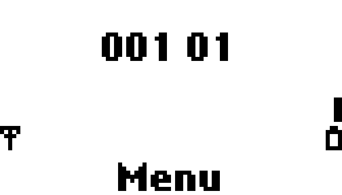
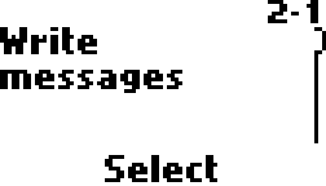

# Verification status

## October 28, 2026 — SIM recheck and DSP message pulse

- A separate simulated-annealing/seed-1 placement is running on the exact
  19,486-site combined-cursor netlist, after its heap placement failed. The
  snapshot is isolated under `build/network-both-cursors-sa`. The process
  crashed during initial placement (Windows exit code 0xc0000005); no routed
  design or timing result was produced.
- Both MDI and DSP reply cursors now use eight bits after their unchanged
  full-width admission checks. DSP transport/wrap, network delivery and CC
  integration tests pass. The combined netlist packs to 19,486/20,736 LUT
  sites, compared with 19,450 for the MDI-only change; the smaller register
  width did not reduce packed area. Heap/seed-1 placement of the combined
  netlist failed to find a legal placement; there is no network image.
- The 400M-cycle SIM-address run with a 168.75M-cycle power hold completed,
  with identical initial/final stimulus hashes. Its final framebuffer again
  shows Net Monitor 03 and Menu. Matching the board's Power duration therefore
  did not reproduce Insert SIM card under these simulated conditions.
- The narrowed MDI cursor passes queue wrap/ownership tests and DSP access/CC
  integration. The current network netlist packs to 19,450/20,736 LUT sites
  (93%); heap/seed-1 placement failed to find a legal placement and produced
  no image. This count includes the recent USB changes
  too, so it is not an isolated measurement of the cursor edit.
- `nokia_top --virtual-network` does not place on the Tang Nano 20K after
  the 8-bit MDI cursor change (`726aa2f`): nextpnr (`heap`, seed 1) reports no
  legal placement at 19,450/20,736 LUT4 (93%), 7,763 DFF, 24/46 BSRAM; `sa`
  seed 2 aborts during initial placement. No image was produced. The full RTL
  suite still passes. Per-module yosys LUT4 counts put the network blocks at
  only about 1,000 LUT4 (`dsp_service` 310, `virtual_cell` 150, `mdi_injector`
  127, `mm_registration` 116, `sim_chv` 112, `virtual_access` 77), so the
  limit is overall density, not one oversized block. Network on the board
  remains unverified.

- Corrected SELECT metadata in the hardware-power-hold simulation identifies
  six `9404` responses for requested FIDs `7f40`, `6f14`, `7f40`, `6f16`,
  `6f48`, and `7f43`, all with P1/P2 zero and P3 two. The firmware proceeds
  to successful phonebook record reads. This partial run does not establish
  whether those missing files cause a later rejection; it is still running.
- The board image with both UART fairness and audio-reconnect fixes completed
  routing and timing: system Fmax 35.89 MHz and pixel Fmax 143.45 MHz, above
  the required 16.875/27 MHz. SHA256:
  `24f8bbe47ee02c1eacee47b84bca97406d4e6c7bc46f08f7a2d5f36d90bd3077`.
  Loading again failed before writing at FTDI USB reset. Both fixes therefore
  remain unverified on hardware. A new SIM-address trace is running with the
  board's 168.75M-cycle power hold and corrected SELECT metadata.
- The SIM-result run completed 400M cycles with unchanged key-script hashes,
  network disabled, 127 SIM completions and the same six SELECT refusals.
  Its final `lcd.pgm` shows Net Monitor 03 and Menu, rather than Insert SIM
  card. Thus this simulated startup does not reproduce the hardware rejection;
  the SELECT failures alone do not explain that difference.
- The SIM-result trace reached 300M cycles with 127 completed commands:
  88 responses `9000`, 11 `9f22`, 22 `9f0f`, and six SELECT responses `9404`.
  Phonebook and SMS record reads completed successfully, and the framebuffer
  showed the original Time prompt. This run predates the correction that logs
  the requested FID on failed SELECT; the FIDs of its failures are therefore
  stale selected-file values and must not be interpreted as requested files.
  It has not reproduced the board's eventual SIM rejection at this point.
- The fairness-fix board build completed routing and timing: system Fmax
  41.22 MHz (required 16.875 MHz), pixel Fmax 140.21 MHz (required 27 MHz).
  Bitstream SHA256 is
  `c77402fcd740becde78c1075f7cabf9e46f9003d4fde4345e5460e7906c446ac`.
  This image predates the later audio-reconnect fix. SRAM loading failed at
  JTAG initialization (`ftdi_usb_reset failed`); no write was performed and
  hardware behavior of the fairness change remains unverified.
- The current-RTL 820M-cycle original-ROM simulation completed and reproduced
  CONNECT ACK at 656,617,583, RELEASE COMPLETE at 775,784,675 and DISC at
  787,697,511. This verifies the simulated outgoing signalling sequence;
  it does not establish voice, SMS or network operation on the board.
- A host reconnect could miss unchanged audio state: the previous RTL timed out
  in a reconnect regression, while the new RTL sends the current oscillator
  state after streaming is enabled and passes that test, the packet-framing
  test and the continuous-audio fairness test. This later change is not in the
  already-running FPGA build, and has not been tested on the board.
- A later HDMI capture on the diagnostic board showed the original firmware's
  `Insert SIM card` screen; COM6 opened but delivered no N4 status in two
  reads. This remains an unresolved SIM/USB issue: the screen alone does not
  establish why the SIM was rejected, and the following RTL change has not yet
  been tested on the board. A separate stress test found that continuous audio
  changes starved both screen and status packets (170 audio packets, zero of
  each other type on the previous RTL). The scheduler now gives status and
  screen opportunities and reserves an audio opportunity after a screen.
  The same stress test, existing framing test and full RTL regression pass on
  the changed RTL; a full FPGA build is running.
- JTAG and COM6 were available again. The existing timing-qualified diagnostic
  image was loaded into SRAM; flash was untouched. The Rust menu probe observed
  a system-menu status toggle and verified restoration. HDMI captures then
  showed the original time-entry field before and after the Rust key probe:
  digit 1 appeared after its press and release. Other keys and menu paths are
  not covered by this observation.
- The experimental heartbeat placement and reduced-width SIM ROM simulation
  were interrupted: their process handles disappeared, no corresponding OS
  processes remained, and neither log contained a terminal result. Do not
  infer success or failure from those partial logs. A fresh original-ROM call
  run has started against the current source after both changes were reverted.
- A Rust menu-status probe could open COM6 but received no N3/N4 status; an
  independent Python status read also received none. The present FPGA state
  and whether any menu toggle took effect are unknown. No flash was written.
- Replacing the DSP heartbeat less-than test with equality passed transport,
  MM and CC tests, including a new blocked-ring saturation and release test.
  Its netlist packed to 19,525 LUT sites versus 19,494 before; placement is
  running. The comparator change was reverted to avoid the observed increase;
  the heartbeat test remains and passes with the original comparison.
- A reduced-width SIM byte-pacing counter passed all RTL cases, including a
  new test for exact first and second ATR byte intervals at the Tang clock.
  Its network synthesis packed to 19,530 LUT sites versus 19,494 before,
  and heap/seed-1 placement failed. The counter change was reverted to avoid
  worsening fit; the timing test remains. The original-ROM regression for
  the reduced-width experiment is still running; no hardware image was written.
- Heap/seed-1 placement of the 19,501-site message-pulse netlist failed to
  find a legal placement; it did not produce a bitstream. Its 820M-cycle
  original-ROM regression completed with matching key-script hashes and the
  same CONNECT ACK, RELEASE COMPLETE and DISC cycle points as before.
  The DSP security-command test now verifies every byte of the 52-byte reply.
  Narrower reply-index arithmetic synthesized and packed to 19,494 LUT sites.
  The later placement and ROM run were interrupted when their process handles
  disappeared; their logs are incomplete and prove neither success nor failure.
- After USB reconnection, COM6 opened and the previously timing-qualified SIM
  diagnostic image was loaded into FPGA SRAM over JTAG. The original ROM
  executed at least 123 SIM commands, with no reported bus or memory error;
  a live LCD snapshot showed the Time prompt. This confirms SIM traffic, not
  registration or a successful call. The persistent flash was not rewritten.
- The DSP service now emits a one-cycle message pulse while retaining its
  32-bit diagnostic counter. The network consumes the pulse instead of keeping
  and comparing a second counter. A test checks pulse/counter equivalence,
  including batched descriptors; the full RTL test suite passed. Network
  synthesis and preliminary packing report 19,501/20,736 LUT sites (94%),
  down from the earlier 19,659-site netlist. Placement and an original-ROM
  call regression are running; hardware fit and behavior remain unverified.

## October 27, 2026 — virtual CC and hardware recheck

- The fractional-timer netlist heap/seed-2 placement terminated with `Unable to
  find legal placement for all cells`; no PNR image was produced. A separate
  200,000-clock test at the actual Tang system clock of 16.875 MHz verifies
  the GSM phase and frame count against an independent 64-bit reference across
  multiple frame boundaries. This validates the timer arithmetic, not board fit.

- The fractional timer width change synthesized to 14,441 raw LUT1–4 and
  3,637 ALU versus 14,431 and 3,646 beforehand: the trade saves 9 ALU but
  adds 10 raw LUT. Heap seed 2 placement is running on the new netlist; no
  placement or timing success is claimed. An attempted removal of a pending
  LAPDm UA frame register was reverted before commit because it could replace
  a queued frame when another UA arrives during scheduling.

- The 19,659-LUT network placement also terminated with `Unable to find legal
  placement for all cells`; no routed image exists. GSM fractional-frame phase
  storage is now sized from the configured clock and increment instead of a
  fixed 32 bits. Tests cover the exact threshold, just below it, hyperframe
  wrap, RACH, dedicated scheduling and CC. A synthesis is running; area impact
  has not yet been measured. More resource reduction may still be necessary.

- The synchronous MDI buffer synthesized at 14,431 raw LUT1–4, 3,646 ALU
  and 119 RAM16SDP4 versus 14,438, 3,650 and 145 before the change. Placement
  of this exact netlist reports 19,659/20,736 LUT4 sites (94%) and is still
  running; routing and timing are unverified. The 820M original-ROM run
  completed with matching key-script hashes and again observed CONNECT ACK,
  RELEASE COMPLETE and DISC at the previously verified cycle points. All 43
  RTL cases passed; an additional maximum-size 196-byte MDI record test checks
  all 98 words, producer ownership, and oversized-record rejection.

- Both recent heap placement attempts ended with `Unable to find legal
  placement for all cells`, including CCCH-delta at 19,880/20,736 reported
  LUT sites. No PNR image was produced. The MDI injector now splits its record
  buffer into even/odd banks with synchronous reads and a preparation cycle;
  packet framing, odd padding, long records, ring wrap and FIQ ownership remain
  covered by directed tests, as do DSP RACH and call flows. Full synthesis and
  an original-ROM call run for the new buffer are in progress; actual area,
  timing and firmware behavior remain to be measured.

- The alternate simulated-annealing placement on the 95%-LUT network netlist
  terminated with exit 1 during initial placement; its log has no detailed
  error and no PNR file was produced. The CCCH next-block calculation was
  simplified to use a six-bit delta and explicit hyperframe wrap. A test
  compares the result to the original formula for every one of the 2,715,648
  hyperframe positions; DSP access and call integration tests also pass.
  Full synthesis for this change is running; resource savings and fit are
  not yet known.
  Synthesis subsequently completed at 14,438 raw LUT1–4 and 3,650 ALU,
  compared with 14,470 LUT and 3,636 ALU before this specific change. A
  separate heap placement of this snapshot and a heap seed-2 placement of the
  preceding snapshot are running. Neither is a qualified bitstream.

- The original v6.39 ROM completed two calls in the 1.1B-cycle serial-RX
  simulation: CONNECT ACK at 656,617,583 and 958,499,543; RELEASE COMPLETE at
  775,784,675 and 1,053,830,352; both followed by DISC. Key-script hashes match.
  A separate 820M-cycle run with the iterative frame-number calculations and
  counters completed one call and clearing at the same first-call cycle points.
  These establish simulated signalling for the tested flows, not voice, SMS,
  device placement or operation on Tang. A simulated-annealing placement with
  seed 2 has started on the preserved 95%-LUT network netlist; the prior heap
  placement failed. No successful placement or timing is claimed yet.

- The incremental GSM frame counters synthesize at 14,470 raw LUT1–4 and
  3,636 ALU, down from 14,517 and 3,997 in the preceding variant. The device
  placer reported 19,900/20,736 LUT4 sites (95%) but terminated with `Unable
  to find legal placement for all cells`; no routable network image resulted.
  Further area reduction remains necessary. Independently, the original-ROM
  serial-RX run reached CONNECT ACK and the first End's RELEASE COMPLETE,
  RR ACK and DISC; its second-call/final result remains pending.
- The desktop remote now opens and initializes its serial port on a daemon
  thread. A five-second timeout or user cancellation leaves the Tk event loop
  responsive and disposes of a port that opens late; installer disconnect also
  invalidates pending opens. Tests cover blocked, failed, cancelled and late
  opens plus the desktop polling path. An operating-system driver can still
  retain a stuck COM handle, and writes/close are not isolated by this change;
  real reconnect behavior remains unverified.

- The first serial-RX network placement reported 21,463/20,736 LUT4 sites
  (103%); that experiment was stopped as over capacity before placement
  completed. Replaced the variable-byte selector in the dedicated-frame
  generator with a backpressure-safe shift register: its synthesis reduces
  raw LUT1–4 from 14,809 to 14,747 and ALU from 4,774 to 4,770. Also replaced
  wide request-FN division/modulo with a 22-clock iterative calculation; it
  holds the packet until fields are ready. Tests cover full custom frames,
  stalls, 32 request FNs including the 22-bit maximum, RA correlation and
  DSP access/CC integration. Full synthesis with both changes completed at
  14,517 raw LUT1–4, 3,997 ALU, 145 RAM16SDP4 and 15 DPX9B. This saves 230
  raw LUT and 773 ALU compared with the frame-shift-only synthesis. Placement
  of this exact network netlist reported 20,335/20,736 LUT4 sites (98%) and
  terminated with `Unable to find legal placement for all cells`; it produced
  no qualified bitstream. A further optimization maintains FN mod 51 and mod
  42432 counters incrementally instead of wide combinational modulo. Tests
  verify frame-counter tracking, hyperframe wrap, relative RACH correlation,
  dedicated channel timing and CC/RX integration. Synthesis with the counters
  is in progress; no updated device-fit or timing claim is made yet.

- Initial full-network synthesis completed but is far beyond Tang capacity:
  111,678 raw LUT1–4 cells, including approximately 93,164 associated with
  the LAPDm receiver's 20 simultaneous byte writes. This is synthesis evidence,
  not a placed image. Reworked reception to write one byte per clock through
  a single memory port; `frame_ready` stays low while copying and the ACK is
  emitted only after the final byte is stored. A same-link reset aborts an
  in-flight copy without delivering or acknowledging stale data. Directed RX,
  DSP reassembly and complete outgoing call/clearing tests pass. A new full
  network synthesis and a two-call original-ROM simulation are running;
  resource fit and firmware equivalence are not yet established.
  An additional directed test verifies all 256 reassembled bytes, sequence
  number wrap and rejection of a further byte beyond the message limit.
  The serial receiver's full-network synthesis completed at 14,809 raw LUT1–4
  and 4,774 ALU, versus 111,678 and 4,918 with parallel writes; the receiver
  adds one block RAM. This is not a device-fit result. Placement is running
  on that exact pre-reset-handshake netlist snapshot. A subsequent change makes
  `frame_ready` low during reset or link reset so a held input frame cannot be
  spuriously accepted and acknowledged after a reset; RX capacity and DSP/CC
  tests pass. The placement experiment predates this last change.

- Added an explicit `nokia_top` virtual-network parameter and
  `tools/build.py nokia_top --virtual-network` option. The default board build
  remains network-disabled; experimental outputs and build receipts are kept
  in `build/nokia_top_lut4_virtual_network`, separate from the diagnostic image.
  A failure-injection test checks the parameter override, receipt and that the
  normal image is preserved. The first full network synthesis is in progress;
  no device-fit, timing or hardware call is claimed until those are verified.

- After the user's USB reconnection, JTAG/COM6 returned and the diagnostic
  image was reloaded into SRAM. The original ROM processed at least 135 SIM
  commands: the observed last command changed from READ RECORD (`b2`) to
  SELECT (`a4`), with ROM done and no reported memory/bus errors. A USB LCD
  snapshot after dismissing the Time prompt showed Insert SIM card, but the
  SIM counter subsequently advanced from 126 to 135. Thus the message does not
  mean that no SIM exchange occurred; the sampled screen alone does not prove
  persistent rejection or accepted SIM. A later screen capture blocked on
  COM6 again; diagnosis of the eventual phone state remains open.

- The SIM-diagnostic FPGA build completed routing and timing (system Fmax
  42.78 MHz, pixel 162.84 MHz); bitstream SHA256
  `f65b188f3a3f19242db5a173c9e7f55b404299b5009123a54e259976bf6afddd`.
  SRAM load succeeded, but `read_sim_status.py COM6` blocked inside serial
  access without returning a packet. Windows still enumerated COM6/FTDI;
  subsequent standard open returned access denied. Termination was requested
  for the identified diagnostic process, which remained listed; no SIM count
  can be inferred. USB reconnection is needed before reloading this volatile
  diagnostic image and retrying. Flash was not written.

- Two no-network original-ROM comparisons are running with independent
  Verilator build directories: the earlier 27M-cycle power hold and a new
  168.75M-cycle hold matching the Tang's ten-second automatic power press.
  This investigates a startup difference; no causal claim is established yet.
  The first run's 350M framebuffer shows the Time prompt also observed on Tang.
  `trace_firmware.py --build-dir` isolates generated source/object files for
  different simultaneous configurations; each run records the build directory.
  At 400M cycles the first run (27M power hold, network disabled) displays the
  original Net Monitor 03 standby and Menu, after the scripted C presses. Thus
  disabling the virtual network alone does not reproduce the board's observed
  Insert SIM screen under these simulation conditions. The ten-second hold and
  actual board diagnostic remain necessary to identify the difference.
  The ten-second-hold run also reached 400M and its 84×48 framebuffer is
  pixel-identical to the short-hold run at that point (Net Monitor 03 / Menu).
  Therefore the board's ten-second automatic power hold alone does not explain
  the observed Insert SIM screen under the tested simulation conditions.

- Added an explicit hardware diagnostic selector for SIM APDU completion count
  (24-bit modulo counter) and the last instruction byte, carried in the N4
  status address field only while opcode 7 bit 6 is selected. Bit 7 retains
  priority for the existing PC diagnostic; normal address reporting resumes
  with opcode 7 value zero. `tools/read_sim_status.py` selects/restores the mode
  and prints decoded status; it cannot recover APDU contents or history.
  All 41 RTL cases and the decoder unit test pass. A diagnostic board
  build and a no-network original-ROM comparison are running; hardware SIM
  exchange and full APDU-level cause remain unverified.

- The original-ROM two-call simulation completed 1.1 billion cycles with 45,920
  LCD writes and matching initial/final keypad script hashes. Both calls reached
  CONNECT ACK, followed by RELEASE COMPLETE and DISC after End. This confirms
  simulated signalling, not speech or a physical call.
- The optimized pre-network build routed and passed timing (system 33.02 MHz,
  pixel 141.08 MHz). Its bitstream SHA256 is
  `69ce105501a1560d11854b0ebee9e79222ba98c165f12f1a61d46f8146d8e5eb`.
  It was loaded into Tang SRAM and executed the ROM without reported memory or
  bus errors, but the original UI still displayed Insert SIM card. It was not
  written to flash or qualified for the installer; SIM diagnosis remains open.

- In the running original-ROM two-call experiment, the first End now completes
  the real clearing sequence: DISCONNECT at 763,865,917, RELEASE ACK N(R)=5 at
  771,810,263, bare RELEASE COMPLETE (`03 2a`) at 775,784,675, RR release ACK
  N(R)=6 at 783,726,264 and DISC at 787,697,511. This directly verifies the
  established-call clearing path for v6.39 in the RTL model. The second call
  and this run's final state remain pending; physical Tang signalling remains
  disabled until the network build is qualified.
  The [800M framebuffer](img/simulation-original-cleared.png) shows ordinary
  001 01 / Menu standby after clearing; it is a simulation capture.

- Refactored the ARM banked register file to one physical RAM write port and
  31 validity bits. Reset clears validity; architectural/debug/save-state and
  verification reads still return zero for unwritten words. PC offsets, bank
  selection and save-state/debug/CPU write priority are preserved. The 5,000-
  cycle randomized register-file test covers all restore slots, resets, banks,
  force-user accesses, debug while CLKEN=0 and physical snapshots. ARM/Thumb,
  FIQ and the full 41-case RTL suite pass. Simulation register traces are masked
  consistently; raw RAM contents after reset are not architectural state.
  Pre-network board synthesis changes raw LUT1–4 from 15,156 to 11,814, DFF
  from 6,199 to 5,268, RAM16SDP4 from 43 to 91 and ALU from 2,820 to 2,825.
  New placement is running against a separate netlist snapshot. The older
  multiplier-only placement was deliberately stopped as superseded by this
  much smaller design; it is not recorded as a placement infeasibility proof.
  Current-source placement/timing, original-ROM and hardware gates remain open.

- Added established-call clearing for the observed phone DISCONNECT. The CC
  peer validates the mandatory Cause LV and trailing bounded TLVs, sends
  RELEASE, waits for its LAPDm ACK and the matching bare RELEASE COMPLETE,
  then reliably sends RR CHANNEL RELEASE. It marks clearing complete only
  after that final I-frame is acknowledged; DISC/UA releases the SDCCH and
  resets the call state. Directed DSP-queue tests now cover this whole chain,
  including piggyback acknowledgements. Unit tests reject truncated/malformed
  cause data and wrong transaction IDs without claiming successful clearing.
  Early cancellation during call setup, optional Release Complete IEs,
  incoming calls, speech transport and SMS still need implementation.
  A static two-call original-ROM experiment (`two-call-clear-1100M`) is running
  with End at 760M and 1040M; it also uses the optimized multiplier. Its result
  is not yet established by the directed tests.
  All 40 RTL cases pass after the clearing integration. The pre-network CHV
  placement experiment is still alive (CPU usage checked while its log was
  quiet); no placement success or failure is inferred from log silence.
- The prior original-ROM run completed 820M clocks, 33,056 LCD writes, 305 virtual
  records and 621 consumer changes. Its initial/final script hashes differ
  because End was added live before 760M; the preserved initial script, final
  script and actual KEY events explain that deliberate change.

- The original v6.39 ROM has now sent CONNECT ACK (`03 0f`) at cycle
  656,617,583 in `cc-connect-820M`, after N(R)=2/3/4 confirmations for the CC
  handshake. Its 675M framebuffer shows the original **Call 1 / End** screen:
  [simulated connected call](img/simulation-original-connected.png). This proves
  the outgoing signalling transition in the virtual RTL model, not speech
  transport or a call on the physical Tang. The running experiment uses the
  pre-multiplier-optimization executable. To observe clearing next, the live
  script was extended before cycle 760M with End at 760M/release at 765M; its
  original script is preserved separately and the harness records the final
  script/hash and actual KEY events. The run is not yet complete.
  End was observed exactly at cycle 760,000,000; the phone sent DISCONNECT
  `03 65 02 e0 90` at cycle 763,865,917 (N(S)=3, N(R)=4), carrying normal-call
  clearing cause 16. At that snapshot the virtual peer retained the request
  without a RELEASE exchange. The implementation above now adds this path;
  its original-ROM clearing result remains pending.

- Replaced the ARM multiplier's replicated-sign 64x64 expression with an exact
  signed 33x33 product (conditional sign bits) truncated to 64 bits before
  accumulation. All 512 boundary and 20,000 deterministic random comparisons
  against the previous expression pass, including results, N/Z, write mask and
  early-termination cycle count. The full 40-case RTL suite also passes.
  Board synthesis reduces MULT36X36 cells from 3 to 1, ALU from 2,884 to 2,820
  and raw LUT1–4 from 15,217 to 15,156 versus the archived pre-network CHV
  synthesis. This is a resource reduction, not proof of full network fit.
  Heap/seed-1 placement of the revised pre-network board is in progress;
  no resulting image has been programmed or hardware-qualified.

- Tang USB is available again: FTDI serial 2023030621B on COM6; JTAG detects
  Gowin ID 0x81b. Without rewriting FPGA or ROM, UART reports SDRAM ready,
  ROM done, PLL locked, increasing LCD writes, no memory/bus errors and no LCD
  overflow. Thirteen live LCD frames were captured after the user's replug.
  The original Time prompt responds to C, then shows **Insert SIM card**.
  [Actual board LCD over USB](img/hardware-coldboot-sim-required.png) is an
  enlarged framebuffer, not HDMI capture. This verifies flash boot/control,
  not accepted SIM or a fully working phone. The installed image still needs
  SIM qualification; newer CHV/network logic has not been installed.
- Connected an experimental MO speech CC handler to retained L3 RAM and the
  reliable SAPI-0 transmitter. It parses bounded SETUP TLVs, a speech bearer
  and called-party BCD, sends CALL PROCEEDING / ALERTING / CONNECT with ordered
  LAPDm acknowledgements, and marks a call active only after the matching
  original-transaction CONNECT ACK. Unsupported/malformed requests stay
  retained; no connection is claimed on link timeout or wrong transaction ID.
  DSP-queue tests cover original v6.39 SETUP for 12345, CM mode-complete buffer
  release, all three replies, piggyback CONNECT ACK and link/reset cleanup.
  The parser also checks duplicate/missing IEs, invalid/filler BCD, unsupported
  data bearer/address extension, truncated and 256/257-byte bounds.
  This is signalling only: incoming calls, setup cancellation, speech audio
  and SMS are unfinished. The isolated `cc-connect-820M` ROM run was in
  progress; CONNECT ACK has since been observed above, with clearing pending.
  All 39 RTL cases and four trace-parser tests pass after this integration.
- The previous ownership-fix run completed 700M clocks with 33,908 LCD writes,
  215 virtual records and matching keypad-script hashes. SETUP is followed by
  idle uplink blocks rather than the former repeated SETUP; no CC response
  existed in that run, so it does not establish a connected call.

## October 26, 2026 — original boot investigation

- The isolated `cm-cipher-740M` v6.39 run completed: 740M clocks, 36,602 LCD
  writes, 242 virtual records, matching initial/final keypad-script hashes.
  Original requests now contain Ciphering Mode Complete (`06 32`, N(S)=0,
  cycle 632,784,634), followed by CC SETUP (`03 45`, N(S)=1, cycle 636,756,200).
  SETUP carries called-party BCD `81 21 43 f5` (12345). Subsequent copies retain
  N(S)=1 and set P=1: they are retries, not additional calls. The original UI
  displays **Calling...**, not an established conversation.
  [Original simulated calling screen](img/simulation-original-calling.png)
  is the 650M framebuffer enlarged with nearest-neighbour scaling; it is not a
  physical HDMI capture. The run predates the L3 ownership fix, explaining the
  unacknowledged SETUP. A fresh isolated ownership-fix run is now in progress.
- Added a reliable one-outstanding-I-frame transmitter for future CC/SMS
  responses. Independent SAPI 0/3 instances validate RR/piggyback ACK framing,
  maintain modulo-8 N(S), retain exact payload/sequence under stalls and retries,
  reject ACKs for unsent output, accept delayed retry ACKs and bound retry
  exhaustion without reporting success. Directed tests pass for both SAPIs,
  including malformed/other-SAPI ACKs, wrap and reset. This transmitter is not
  connected to a CC/SMS service yet; calls and SMS remain unfinished.
  The complete 37-case RTL suite and four trace-parser tests pass.

- Added synchronous L3 header inspection over the retained LAPDm message RAM.
  Ownership is released only after a consumer accepts the inspected message;
  header fields, SAPI and full 9-bit length remain stable under backpressure.
  The CM peer now exposes its active state, allowing its handled two-byte
  Ciphering Mode Complete to be consumed. This prevents that message from
  blocking the next CC SETUP. Other messages remain pending for their future
  handlers; this is not CC/SMS implementation. Header state resets on channel
  changes and link establishment. Unit/integration coverage checks synchronous
  read latency, short/256-byte messages, reset, mode-complete consumption and
  retention of the following CC message. The running `cm-cipher-740M` experiment
  predates this ownership fix; its executable is left intact until completion.
  The complete 36-case RTL suite passes after the ownership integration.

- October 27: the isolated 850M-clock v6.39 dial experiment completed with
  42,260 LCD writes and 326 virtual records. The original phone sent a SAPI-0
  SABM containing CM Service Request (`05 24`, MO call) at cycle 620,871,835.
  The old FPGA peer had no CM response; subsequent idle uplink blocks do not
  establish a successful call. Input script hashes match before/after the run.
- Added an experimental CM establishment branch: a complete CM Service Request
  with Classmark 2 and a valid 15-digit IMSI queues `06 35 01` (A5/0 Ciphering
  Mode Command), after the scheduler's UA gate. It retains the frame under
  backpressure, retries missing N(R)=1 acknowledgements and accepts an ordered
  `06 32` Mode Complete, including a piggyback ACK. It never reports location
  registration or call completion for this exchange. CC SETUP handling, L3
  dispatch and SMS remain unfinished. A new isolated original-ROM run is in
  progress; its result is not yet qualified. DSP trace capture now retains up
  to 32 payload bytes rather than 12, allowing complete SEND_BLOCK inspection.
  All 35 RTL cases and three trace-parser tests pass. Coverage includes malformed
  CM requests, wrong sequence numbers, stalled/retried cipher output, piggyback
  mode-complete acknowledgements and UA-before-command DSP queue ordering.
  This branch is not installed on the physical Tang; full CHV/network fit is
  still unresolved. USB was unavailable during that check; it was restored in
  the October 27 hardware recheck above.

- Tested simulated-annealing placement (seed 2) on the historical pre-network
  CHV synthesis snapshot. The process terminated during initial placement with
  no output PNR JSON and no useful terminal error in its captured log. This is
  a failed experiment, not a placed/routed image or a current-source qualification.
  The snapshot hash and experiment scope are retained locally. Current full
  CHV/network fit remains unresolved.
- `build.py` now accepts explicit `--placer` and `--seed`, preserves default
  heap/seed-1 behavior, and records both in build-result JSON even on failure.
  The failed-build regression passes with nondefault options while still proving
  the old .fs is preserved separately and cannot masquerade as the new output.

- Completed an isolated 850M original v6.39 experiment that exits Net Monitor,
  enters test number 12345 through Nokia keypad events and presses Call. It
  runs entirely inside the virtual model; no physical cellular call is made.
  It reached the CM Service Request described above; no CC connection completed.
- `tools/trace_protocol.py` now summarizes observed DSP request prefixes into
  SABM/RR/I/DISC events, sequence numbers, SAPI/PF and captured/declared lengths.
  It explicitly marks truncated payloads, ignores stale sub values for empty
  commands and does not classify I-frame continuations as fresh L3 messages.
  Two parser tests pass; the saved Net Monitor trace yields the actual N(R)=1,
  N(R)=2 and DISC sequence. Reports intentionally make no service-success claim.

- Connected LAPDm I-frame reception to SEND_BLOCK and scheduled SDCCH RR output.
  Accepted segments advance N(R); duplicates are re-ACKed without duplicate L3
  delivery, including while a completed L3 message remains pending. SAPI 0/3
  RR work is retained separately, with P/F preserved. A DSP-queue integration
  test covers segmented input, exact reassembled bytes, scheduled RR and loss/
  retry of the final acknowledgement. All 35 RTL cases pass. L3 messages are retained, not consumed as
  successful calls/SMS; the L3 dispatch/readout path is still incomplete.
- The Net Monitor exit experiment completed all 600M clocks with 26,618 LCD
  writes, 146 virtual records and 300 consumer changes. Its initial/final key
  hashes match, and the applied-key log records the controlled menu sequence.
  The normal `001 01` standby frame is simulation evidence only; current FPGA
  source fit, hardware network operation, calls and SMS remain unqualified.

- The repeated main-screen fields are now identified as Net Monitor, not a font
  rendering defect. In the isolated original v6.39 run, Menu -> Up reached the
  original Net monitor item; selecting it, entering test 0 and confirming returned
  to a normal standby LCD showing numeric network `001 01` and the Menu softkey
  by cycle 525M. No MCU RAM or framebuffer was patched. This is RTL simulation
  evidence, not an HDMI/Tang capture; stable service, calls/SMS and the same exit
  on hardware still need qualification.

- Added a standalone LAPDm I-frame receiver with independent SAPI 0/3 sequence
  and reassembly buffers. Directed tests cover interleaved segments, duplicates
  without duplicate delivery, out-of-order/invalid frames, bounded overflow,
  message backpressure, link reset and N(S) modulo-8 wrap. All 34 RTL tests pass.
  The receiver is not connected to SEND_BLOCK or L3 dispatch yet; acknowledgements,
  rejection signaling and complete call/SMS transactions remain integration work.

- Fixed stale LAPDm responses across channel boundaries. UA decoding now requires
  an active SDCCH; every channel reconfiguration clears pending UA and MM-output
  eligibility. A DSP-queue test sends unsolicited SABM before channel setup,
  then queues a valid SABM and reconfigures before its UA slot. It verifies that
  neither response leaks into the new connection. The directed test passes;
  the original Net Monitor exit experiment currently running predates this fix.

- The isolated 600M standby run completed with 25,406 LCD writes, 146 virtual
  records and 300 MCU consumer changes. Main-screen repeated fields may be a
  Net Monitor diagnostic page (index 03), rather than damaged glyph rendering;
  this is a hypothesis, not yet proven. Its final frame is a readable Phonebook
  Search/Add name/Erase menu. Late live edits to the key script did not provide
  a controlled Net Monitor exit test, so a new static-script 600M experiment
  is running through original menu input without firmware RAM patches.
- Trace harness now logs actual KEY mask transitions with their applied cycle;
  run manifests retain both initial and final stimulus hashes and save the final
  script. A 100-cycle smoke run confirms the cycle-0 key log and matching input
  hashes. These diagnostics are not phone-boot or registration evidence.

- LU recognition now validates mandatory structure and Mobile Identity rather
  than accepting a two-byte MM header. Supported identities are a 15-digit
  decimal IMSI or a correctly sized TMSI; LI/identity lengths and LU type must
  agree. Tests cover a full request, BCD errors, truncated/header-only requests,
  identity-length mismatch and a valid TMSI. DSP/MM integration fixtures now use
  a full 18-byte LU request. All 32 RTL cases pass. This is format validation,
  not subscriber authentication or complete MM parsing.
- The isolated standby run reached frame 425M after scripted C presses. Visual
  inspection shows a readable Menu softkey but repeated/corrupt main text;
  normal standby UI and operator display are still not verified. The protocol
  exchange alone must not be described as a completed phone implementation.

- Completed the modeled SDCCH release path: after a valid DISC, the scheduler
  commits its UA before disabling dedicated fill/uplink-request events and
  clearing pending dedicated work. MM completion is retained. The extended
  queue integration test consumes DISC UA and verifies silence over multiple
  following scheduling intervals; all 32 RTL tests pass. This fix is not in
  the currently running isolated standby experiment and is not hardware-qualified.
  Tang USB UART/JTAG interfaces were not present at the latest device check.

- Original-ROM trace output is now isolated per run under `build/trace-runs/`.
  Each run records ROM/RTL/harness hashes, clock, virtual-network flag, memory
  stalls, cycle limit and terminal status. Frames and RAM are written only to
  that run directory; a nonempty explicit directory is rejected. Reuse checks
  compiled RTL/options and harness hashes instead of trusting an old executable.
  A 100-cycle original-ROM smoke run produced its own log/LCD/RAM and completed
  manifest; it is not phone-boot evidence. A 600M virtual-network run with C-key
  dismissal of startup dialogs is being compiled/run in a new isolated directory.
- The full RTL suite now passes 32 cases after I-frame acknowledgement handling.

- In the first MM-integrated v6.39 run, firmware sends RR N(R)=1 at cycle
  287,212,579, RR N(R)=2 at 291,183,204 and DISC at 295,155,177. This is actual
  acceptance of LU Accept and Channel Release, not just the synthetic test peer.
  A current-run LCD frame does not yet establish normal registered standby;
  registration UI, serving-cell state, subsequent access and call/SMS remain
  unverified. Old frame files from other runs must not be used as evidence.
- MM acknowledgement handling now also accepts N(R) piggybacked in valid
  SAPI-0 I-frames, with LI/length validation. Directed tests reject truncated,
  wrong-SAPI, invalid-EL and duplicate/wrong-N(R) acknowledgements. Uplink L3
  parsing/reassembly remains separate and incomplete.

- MM downlink I-frames now have bounded retry handling: one second of model
  clocks after output acceptance, at most three retransmissions per stage.
  Backpressure before acceptance does not consume attempts. Retries retain the
  original data and N(S); delayed valid ACKs cancel queued retries. Exhaustion
  exposes failure without claiming registration. Directed retry tests pass for
  lost LU/release ACKs, unchanged frames, output stalls, failure and recovery.
  The original-ROM experiment currently running predates retries. This is an
  experimental reliability mechanism, not a complete LAPDm T200/N200 model.

- Connected the minimal MM peer to actual SEND_BLOCK decoding and scheduled
  SDCCH downlink. LU Accept is gated until UA is committed; pending MM I-frames
  replace later idle fills and advance only on received RR acknowledgements.
  A full DSP-queue integration test drives padded SABM, verifies UA then the
  configured LU Accept, injects N(R)=1, verifies Channel Release and injects
  N(R)=2. All 30 RTL cases pass. The peer-complete state is test evidence only,
  not proof that original Nokia firmware registered.
- The UA-connected original-ROM experiment completed 400M clocks with 17,324
  LCD writes, 147 virtual records and 299 consumer changes. Later SEND_BLOCK
  payloads are idle `00800103012b...` rather than repeated SABM. Its trace/RAM
  are archived before a new 500M experiment with MM responses. Original-firmware
  LU acceptance/release and actual registration remain unverified.

- Added a standalone minimal MM location-update peer for an established SAPI-0
  link: a recognized LU request in SABM queues a seven-byte Location Updating
  Accept with the configured PLMN/LAC, waits for N(R)=1, then queues Channel
  Release and waits for N(R)=2. Tests verify output backpressure, latched LAI,
  wrong/duplicate/early acknowledgements, SAPI/protocol/segmentation guards and
  reset. The tests pass. The module is not connected to the DSP downlink yet;
  its completion output is only a model-state result, not verified phone
  registration. It omits retransmission, authentication, complete request parsing,
  I-frame reassembly, MM Information and call/SMS service.

- The dedicated-scheduling original v6.39 trace emits real SEND_BLOCK `1B`
  requests with SABM data, including prefix `0080013f4905087000f110ff...`.
  Their DSP payload length is 28 bytes, so the decoder now accepts ROM6 padding
  after the first 23 on-air LAPDm bytes instead of rejecting lengths above 25.
- Connected SEND_BLOCK decoding to UA validation and the scheduled SDCCH
  downlink. A pending UA replaces the next idle frame, preserving the exact
  original SABM information. The end-to-end test covers padded 28-byte M2D input,
  UA queue/FIQ delivery, SAPI/PF/information echo and leaving the channel.
  All 28 RTL cases pass. A new original-ROM experiment is running to qualify
  actual establishment; MM registration acceptance and I-frame handling are
  still missing. No working registration/calls/SMS are claimed.

- Added standalone LAPDm SABM/DISC acknowledgement logic. UA echoes the exact
  SABM information field for contention resolution, preserves SAPI and P/F,
  pads unused bytes and rejects truncated/oversized/segmented frames, invalid
  EA/EL, unsupported LPD/spare bits, non-U commands and DISC with information.
  Directed tests pass for SAPI 0/3, maximum 20-byte echo and reset. This block
  is not yet connected to SEND_BLOCK decoding or scheduled downlink delivery;
  it does not implement MM registration, call control or SMS.

- Added experimental SDCCH scheduling after a real logical-channel `80` request.
  It emits MDI RECEIVED_BLOCK with an empty LAPDm UI frame on each 51-frame
  boundary, followed by MDI `86` uplink-block request at frame offset 15 after
  the first fill has completed. The generator, DSP queue/FIQ integration, frame
  alignment and stopping dedicated events on channel change pass directed tests.
  The integration clock is 10 kHz: at 1 kHz the deliberately stalled bus consumes
  more than a scheduling interval and a receiver must drain extra queued fills.
  All 27 RTL cases pass. A 400M-clock original-ROM experiment is running to
  check actual SEND_BLOCK/uplink behavior. LAPDm acknowledgement, location update,
  call control and SMS are not implemented by this idle/request generator.
- The preceding corrected RACH/CCCH experiment completed 400M clocks with 17,324
  LCD writes, 81 virtual records and 167 receive-consumer changes. Its trace/RAM
  are archived before enabling dedicated scheduling; it does not prove service.

- The first integrated-RACH v6.39 experiment reaches an SDCCH configuration:
  opcode `02`, payload `04000000027101808000024a...`, at cycle 266,399,223.
  It completes 400M clocks with 17,324 LCD writes, 80 virtual records and 165
  MCU consumer changes. This is evidence that the phone accepted an access
  assignment, not completed registration or a working call/SMS service.
- Corrected two access-model issues found during review: the Immediate Assignment
  radio-prefix frame now uses a fresh scheduled CCCH block (6/12/16/22/26/32/
  36/42/46 within a 51-frame multiframe), independently of the original RACH
  reference inside the L2 message; a later RACH with updated transmitted FN
  replaces an unsent grant and receives new RA_INFO instead of being ignored.
  Tests cover reduced-FN wrap, CCCH/hyperframe alignment and latest RA/FN grant
  correlation. All 25 RTL cases pass. The updated 400M original-ROM experiment
  is running; hardware remains unchanged and registration remains unverified.

- Connected experimental RACH requests to `virtual_access`: the DSP decoder
  snapshots six request bytes, captures RA and derives the request FN from the
  explicit-frame mode or current frame plus offset. The scheduler delivers
  RA_INFO first, waits CLK_HZ/10, then sends a correlated Immediate Assignment.
  The shared injector preserves unread MCU data even past the grant deadline.
  The new integration test checks actual M2D request decoding, RA_INFO/FIQ,
  unread-queue protection and grant RA/FN bytes across ring wrap. All 25 RTL
  cases pass. An original v6.39 400M-clock experiment is running to check whether
  firmware accepts the grant; no dedicated-channel establishment or registration
  is claimed yet. This fixed-cell prototype handles one outstanding RACH and
  has not been qualified on the physical FPGA.

- Added a standalone `virtual_access` RACH response builder. It emits MDI `84`
  RA_INFO and an MDI `80` CCCH Immediate Assignment using the same captured
  RA/request frame. Directed tests check the request-reference T1'/T3/T2 tuple,
  the 42,432-frame reduced-FN period, SDCCH channel description, byte lengths,
  padding, stalled output, latched inputs and reset cancellation. These pass.
  The block is not connected to the DSP scheduler yet: request-FN decoding,
  RA_INFO-before-grant sequencing and original-ROM acceptance remain required.
  It does not establish registration, a call or SMS.

- The NO_PSW experiment advances beyond repeated search: v6.39 configures CCCH
  (`02`, payload `040000000000001a6000024a...`) at cycle 261,129,071 and emits
  RACH request opcode `0C`, payload `0000166c00000000`, at 261,375,575. This is
  an observed access attempt, not completed location update or registration.
  The 300M trace/RAM/LCD are archived locally before the next transport run.
- A new failing test exposed skipped M2D commands: one producer notification
  spanning multiple descriptors acknowledged the entire range after processing
  only its first record. DSP transport now acknowledges each descriptor, retains
  pending work until the producer cursor is reached and skips halfword padding
  for odd payload lengths. Batched, odd-length and zero-length tests pass; all
  23 RTL regression cases pass. Zero-length telemetry no longer reports stale sub.
- Placement after PIN-format optimization still failed at 18,883 LUTs; the
  current source has no qualified full CHV/network hardware image yet.

- The 300M-clock ALL_RSSI experiment completed with 7,406 LCD writes, 51 virtual
  records and 106 consumer changes. At cycle 228,450,273 firmware asks for a
  second blind scan, then emits targeted search `56` at 228,650,894 and BCCH
  configuration `02` at 228,757,230. The scan response supplies a candidate,
  but firmware still loops rather than establishing verified service.
- Added the reference ROM6 search-termination sequence: after an actual BCCH
  channel request, send one-byte MDI `8F` NO_PSW_LEFT before `89` confirmation,
  once per targeted search. The request decoder now exposes logical channel;
  arbitrary non-BCCH configuration does not trigger search termination. Tests
  verify ordering, subsequent SI scheduling/wrap, traffic confirmation, long
  ALL_RSSI delivery and no replay on repeated BCCH configuration. All 23 RTL
  cases pass. A new original-ROM experiment is running; no registration or
  hardware qualification is claimed for this experimental sequence.

- Actual v6.39 request payload logging confirms search ARFCN 586 (`024a`) and
  the following 20-byte channel configuration prefix
  `04120200000000505000024a`. Blind search emits four payload bytes `03050000`.
  In the new ALL_RSSI experiment, its report is committed at cycle 160,635,698
  and firmware subsequently emits opcode `03` with zero payload at 160,825,557.
  This proves a new request after the scan response, not registration. The
  zero-length request's legacy `sub` field is stale and must be ignored.
- The new PIN-format synthesis packs to 18,883 LUTs versus 18,947 before it;
  placement is still running, so no new hardware image is qualified.
- Build failures can no longer leave an older `.fs` under the current output
  name. The old image is preserved with a timestamp and a JSON build receipt
  records synthesis-only, failed or built status. A failure-injection regression
  verifies preservation, absence of a stale output and an explicit failed receipt.

- The corrected one-byte-confirm v6.39 experiment finished 400M clocks with
  17,846 LCD writes, 70 virtual packets and 145 MCU consumer changes. Firmware
  still requested blind search; neither short confirmation nor consumer movement
  establishes registration. Archived locally before starting a separate 300M
  experiment with ALL_RSSI responses enabled.
- Simulation-only trace ports now expose DSP request length and the first twelve
  payload bytes. The harness logs these in byte order, truncating explicitly for
  larger requests, so channel tokens, logical channel and ARFCN can be checked
  against actual firmware output. These trace ports do not enter the FPGA build.

- Added the missing experimental blind-band-search response: DSP opcode `55`
  now requests an MDI `8B` ALL_RSSI report containing the fixture's ARFCN 586
  at level D0 and 39 empty carrier slots. The generator emits 162 payload bytes.
  The injector now buffers up to 196 total bytes (98 words, below the 100-word
  ring capacity) instead of truncating at 64 bytes. Directed tests cover all
  164 bytes through stalled queue writes and wrap, preserved consumer ownership,
  oversized-frame rejection, and actual `55` request-to-response integration.
  All 23 RTL cases pass. The current original-ROM experiment predates this
  change; firmware acceptance of ALL_RSSI is still unverified. Hardware remains
  on its qualified pre-CHV image with virtual networking disabled.

- Review of the reference DSP ROM6 dispatcher exposed an incorrect prototype
  `89` format: channel confirmation is a one-byte correlation token, not the
  ten-byte radio prefix used by RECEIVED_BLOCK. The wrapper now snapshots the
  token from request payload byte 6 (or traffic-logch parity), rejects truncated
  requests for confirmation, and sends a one-byte MDI `89` body. Tests cover
  BCCH and traffic token correlation, odd-byte padding, queue ownership and
  subsequent periodic SI delivery. All 23 RTL cases pass. Original-ROM testing
  with this corrected reply is running; no registration is claimed.
- The earlier long-confirm experiment completed 400M clocks with 17,846 LCD
  writes, 70 virtual packet commits and 145 receive-consumer changes. Its new
  opcode `55` is blind band search according to the reference dispatcher; it
  cannot be treated as evidence of successful channel setup. Its trace and RAM
  snapshot are retained locally for comparison with the corrected reply.

- The new channel-confirm v6.39 experiment shows actual MCU receive-consumer
  movement after virtual packet commits. It also emits a new DSP opcode `55`/
  sub `03` at cycle 160,633,848, whereas the previous 400M-cycle SI-only run
  stopped its DSP requests at opcode `02`. This is evidence of changed firmware
  behavior after the response, not proof of camping, registration or a call.
  The experiment is still running; the meaning of opcode `55` needs tracing.
- PIN format validation now uses local adjacent-padding checks instead of a
  prefix-padding chain. A directed equivalence check covers all 65,536 patterns
  made from digits, FF padding and two invalid byte classes; PIN/PUK and SIMI
  tests pass, including eight-digit PIN replacement and digits after padding.
  Full-top resource impact is being synthesized and is not yet established.

- In the SI3/SI2/SI4 v6.39 experiment, firmware emits DSP opcode `02`/sub `04`
  at cycle 111,049,877 immediately after search opcode `56`. The experimental
  wrapper now answers observed opcode `02` with an MDI `89` channel-change
  confirmation for the configured fixture's BCCH/ARFCN, without editing MCU RAM.
  Tests verify its ten-byte envelope, status, queue commit/FIQ and preservation
  of the periodic SI schedule. The full 23-case RTL suite passes. Firmware
  acceptance of this response is not yet established; it is disabled on Tang.
  This fixed-cell prototype does not yet decode arbitrary channel parameters
  from the request payload and must not be treated as a complete radio model.

- The optimized full CHV build still fails legal placement at 18,947 LUTs;
  the 163-LUT reduction is insufficient. The installed qualified image is unchanged.
- Experimental virtual-cell broadcasts now cycle SI3, SI2 and SI4 after SCH.
  Directed tests verify SI2 neighbour/NCC/RACH fields, SI4 identity and its
  12-octet mandatory pseudo-length, matching LAI and selection/RACH fields,
  stalled output stability and SI3 return after a full cycle. Queue integration
  verifies all four records and interrupt counts. These tests pass; original-ROM
  response is under investigation, with no registration/call/SMS claim.

- MAD2 shadow-register storage now uses one shared read port and one combined
  initialization/CPU write port; the independently consumed MBUS IRQ bit has a
  dedicated mirror. The full 23-case RTL regression passes, including shadow
  reset values, readback across 32 distinct addresses and special read masks.
  Full-top synthesis reduces packed LUT usage from 19,110 to 18,947 (163 LUTs),
  retaining all registers and the new CHV model. Placement is being evaluated;
  this is not a qualified replacement for the installed pre-CHV image.

- Windows [preview 0.2.3](https://github.com/LakoMoor/OpenNokia3310/releases/tag/v0.2.3-preview)
  now ships the combined installer, saved paths, programmer watchdog and the
  explicitly hash-checked qualified pre-CHV FPGA image. ZIP integrity, FPGA
  manifest/hash and absence of ROM files were checked. Final EXE startup passed;
  local audio smoke test opened its stream and wrote 23,520 PCM frames.
  ZIP SHA256 `abefac88bd4697e09677a6bf3cf59e9517b7e7fa01ad57dd1b952ced552eec88`.
  Full combined hardware installation and visual GUI review remain unverified.

- Desktop installer now terminates a stalled programmer after 30 seconds for
  board detection or 10 minutes for backup/programming. It reports failure and
  does not continue the installation. Nine backend tests pass, including a
  real silent child process killed by the watchdog and nonzero-exit log capture.
  Serial diagnostic tools also bound writes to one second after USB loss.
  These changes do not resolve the physical USB disappearance.
- The full installer success message now distinguishes verified flash writes
  and SRAM loading from actual phone boot and subsequent power-cycle testing.

- Tang became available again. Direct programmer read-back of the 2 MiB ROM
  matches SHA256 `5cd18ff08b40f44c9dbe155bc09efbcea15b5037234fa9d54b3e43bac8fcc8a2`.
- Registered-CS ROM probe initially returned all FF, but after the programmer
  initialized/read flash, the same FPGA probe passed full CRC32 `539dcc62` and
  all sampled entry instructions. Initial flash state/wakeup remains a separate
  issue to qualify; registered CS is not yet proof of reliable cold boot.
- The complete registered-CS pre-CHV bitstream then ran original v6.39 on real
  Tang. LCD writes progressed beyond 3,000; C/C/Menu opened the original
  **Phonebook**. The image below comes from actual Tang N4 LCD bytes, not the
  simulator and not an HDMI capture. HDMI/ST7735 appearance still needs checking.
  This successful bitstream does not contain the newer CHV or virtual-network
  changes that have not yet fitted/been qualified in the full device.

- The same qualified bitstream was written to configuration flash with programmer
  verification, after saving a 2 MiB configuration backup. The user then
  disconnected/reconnected USB power. Without a subsequent JTAG load, UART
  confirmed ROM completion and 3,188 original-firmware LCD writes, with no
  memory errors, FIFO overflow or bus fault. This proves one power-cycle boot;
  repeated cold-start reliability remains to be qualified. Both USB interfaces
  had disappeared before reconnecting; a stalled JTAG reset did not prove boot.
  A subsequent menu/capture attempt again lost both USB interfaces, so menu
  response after this particular cold start was not captured. USB stability
  remains unresolved; the successful SRAM Phonebook capture is separate evidence.
  Installed bitstream SHA256:
  `685910747c1699abae97c5ef5ccfe7359f5f4da49178371f2d21956ac5fdf073`.

- The registered-CS full phone build now completes synthesis, placement,
  routing and packing. Post-route Fmax: pixel 141.46 MHz / system 32.80 MHz,
  passing 27 MHz / 16.875 MHz. This build predates the new CHV integration;
  the ROM probe and original phone boot have now passed on real Tang.
- Virtual SIM CHV1/CHV2 now implements verification, change, enable/disable,
  unblock, attempt counters and access protection. Unit and SIMI/APDU tests
  pass, including retained retry counts across card reset and protected IMSI
  reads after session reset. See [test credentials and limits](virtual-sim.md).
- The extended 22-case RTL regression passes after CHV integration.
- Initial CHV full synthesis reached 93% LUT4 and failed legal placement.
  Sequential CHV payload reads restore RAM inference and reduce synthesis
  usage to 19,013 / 20,736 LUT4 (91%), but this also fails legal placement.
  Further CHV storage/logic optimization is in progress; no new CHV bitstream
  is qualified for the board yet.
- The optional DSP network wrapper passes existing local-command transport and
  observed opcode-56→SCH→SI3 delivery tests. It is enabled only in an explicit
  original-ROM simulation experiment; the hardware top remains off pending
  firmware response analysis. Virtual registration/calls/SMS remain incomplete.
- In the actual v6.39 ROM experiment, opcode 56 causes the first virtual-cell
  record at cycle 110,943,074. Subsequent SI3 records are delivered while the
  firmware continues executing and updating LCD (3,752 writes by 250M cycles).
  This confirms transport integration, not a registered serving cell.
- Continuing original v6.39 simulation with eight-cycle external-memory stalls
  and scripted keypad input reached the original **Messages** menu and
  **Write messages** submenu. Captures below are rendered from simulated LCD
  RAM, not HDMI hardware. This verifies menu response in this model; it does
  not verify SMS transmission or the physical board's corrected ROM load.

- A standalone address-dependent write/read test of all 8 MiB SDRAM passed on
  real Tang with zero errors. A separate SPI→SDRAM ROM CRC test failed: expected
  `539dcc62`; different builds produced `6b29a6b9` and `a1e799fa`.
- Direct SDRAM probes matched ROM word 0 but read `ffffffff` at entry 0x200040
  and subsequent instructions. This establishes corrupted loading before CPU
  execution; a correct SPI first word is insufficient boot evidence.
- The SPI chip-select output was combinatorially decoded from multiple FSM
  states. It is now registered and held continuously across all word/DMA
  boundaries. The extended flash test passes. A corrected ROM probe bitstream
  builds and subsequently passed full ROM CRC on Tang after programmer flash
  initialization. The earlier failure is retained here as investigation history.
- The diagnostic build now exposes actual bus address and selectable instruction
  PC instead of replacing zero-LCD telemetry with the first ROM word.
- Original ROM simulation with eight-cycle memory stalls at the board's actual
  16.875 MHz model clock reaches its first LCD write at cycle 23,498,920 and
  completes 200 million cycles with 3,176 LCD writes. This is not a hardware boot.
- Full-system one-action Windows installation passes seven backend tests.
  FPGA and ROM preparation precede backup/writes; ROM failure blocks FPGA write.
- Extended SPI stream regression passes 512 nonuniform ROM words, 0–96-cycle
  DMA backpressure and reset/reload while requiring one continuous CS assertion.
  All 18 existing RTL regressions pass with the registered-CS change.
- Installer paths now persist locally between application launches. A separate
  preferences test verifies round-trip paths and malformed-file recovery.
- A standalone virtual-cell MDI SCH/SI3 record builder now passes directed
  envelope, identity, ready/valid backpressure and reset tests. It is not yet
  sufficient to establish network registration; later integration is described
  above. No virtual registration, calls or SMS are claimed from this test.
- MDI record injection and generator-to-ring integration tests now pass:
  nonempty-ring protection, preserved MCU consumer, bus stalls, e3→80 wrap,
  odd-byte padding, producer commit before FIQ, invalid lengths and reset.
  It is now arbitrated by the optional DSP network wrapper; hardware remains
  disabled while actual firmware registration is investigated.
- See [compatibility goal and reference review](ROADMAP.md) for the remaining
  original-phone and virtual-network acceptance criteria.

## October 25, 2026 — companion apps, LCD palettes and audio

- Re-studied Open Pocket GBC revision `46fea7708ca76c988ad74b646d18184403c031b1`,
  including its Android FTDI channel-B transport and FPGA menu/audio interfaces.
- Android USB-C OTG app: release APK builds; three protocol tests pass. The APK
  installs and launches in an Android 34 emulator. A physical Android OTG session
  remains unverified. Native Android dialer/SMS intents use the Android modem;
  independent FPGA cellular calls still require additional hardware and models.
- Desktop Python remote: source and transport implemented; Python compilation
  passes. A portable Windows build now includes openFPGALoader and its DLLs,
  plus SRAM/flash/ROM installation and mandatory full backup before flash writes.
  Five flasher tests pass; the packaged EXE constructs both UI pages and its
  LCD image without errors. The bundled programmer detects the physical Tang
  without a system OSS CAD Suite installation. Visual window inspection is
  unavailable because the computer-use runtime failed to initialize.
  The same flash-manager backend successfully loads the bundled FPGA image
  into real Tang SRAM using only the bundled programmer/DLLs.
- Desktop PC audio now reproduces N4 device tone state on the default Windows
  output. Three PCM tests verify 1000 Hz pitch, buzzer conversion, mute and
  USB-timeout silence. A live output smoke test opens the Windows stream and
  supplies over 21,000 PCM frames. End-to-end playback from the user's Tang
  still needs user confirmation: the old application currently owns COM6.
- The complete 18-case RTL suite passes. Follow-up tests pass for menu bitmap
  capture, synchronized N4 volume/palette state, and green/gray switching on
  HDMI and all 16,384 ST7735 framebuffer pixels. This verifies framebuffer logic,
  not the physical panel's appearance.
- Python decodes the actual RTL-generated UART stream identically at seven
  chunk sizes, including checksum/oversize recovery and 17-key encoding.
- SIM fixture now advertises only implemented services and marks empty SMS
  records correctly. Extended tests cover record updates, relative selection,
  bounds, 256-byte transfers and power cycling. A one-billion-cycle original
  v6.39 trace completes; this alone does not establish complete SIM/GSM support.
- Buzzer and DSP tone registers drive the new audio path; RTL tests verify
  register byte lanes, oscillators, 48 kHz clocking, mute and explicit output test.
  Physical HDMI/speaker audio has not yet been captured.
- The HDMI capture card was not enumerated in this session. New hardware
  HDMI/audio capture qualification is pending its connection.
- Full synthesis, placement, routing and bitstream packing now pass. LUT4 use:
  18,481 / 20,736 (89%). Post-route maximum clocks: pixel 138.33 MHz against
  27 MHz required; system 37.70 MHz against 16.875 MHz required.
- The new bitstream was loaded into actual Tang SRAM. USB delivered 12 LCD
  snapshots in three seconds. Down/Down/OK selected Gray LCD; status reflected
  the selection and all 504 captured menu bytes matched the expected bitmap,
  digits and highlighted row. Green LCD was restored and confirmed in status.
  The explicit sound test reported 1000 Hz followed by silence; this proves
  device state transport, not audible HDMI/speaker output.
- FPGA bitstream SHA256:
  `b8531bf600204770d9c977897a9e05203cdb6fb4c74b6441346606cd3c39a632`.
- A complete 8 MiB SPI backup was saved locally. Its ROM region differs from
  the earlier Nokia image: another project had replaced the ROM region.
  Nokia v6.39 W was restored at 0x200000 with write/read-back verification.
  The FPGA test uses SRAM and does not replace persistent FPGA configuration.
- Original-phone boot is still failing in this new hardware build: after SRAM
  loading and a second full reset with Power held, ROM loading completes and
  no memory/bus fault is reported, but LCD writes remain zero. Working system
  menu/USB streaming does not establish a working original Nokia UI. Do not
  treat this preview as a stable phone implementation.

## October 22, 2026 — previously verified hardware build

## Real hardware

- Tang Nano 20K, GW2A(R)-18, JTAG ID 0x81b.
- HDMI captured directly using the USB3.0 UHD DirectShow capture device.
- Original v5.79 and v6.39 W firmware reached their original menus on the FPGA.
- v6.39: Phonebook, Settings, Language, English and Russian selection confirmed.
  See the actual captures in [img/](img/). The Russian confirmation reads “Есть!”.
- The full v6.39 image was written at SPI offset 0x200000 with read-back verification.
  A separate complete read-back matched SHA256
  `5cd18ff08b40f44c9dbe155bc09efbcea15b5037234fa9d54b3e43bac8fcc8a2`.
- Original SPI contents, the prior FPGA configuration and the previous v5.79
  ROM are backed up locally and excluded from this repository.
- The final FPGA configuration is now installed persistently in SPI flash,
  starting at 0x000000; the programmed sector range ends at 0x0E0000. The ROM
  starts separately at 0x200000. openFPGALoader write/read-back verification
  passed. Automatic reconfiguration from flash reached the original phone UI.
  A physical unplug/replug cold power cycle has not been performed.
- ST7735S is physically connected, but its displayed output remains unverified.

Repeated boots are not yet reliable. A previous image sometimes ran without
producing LCD writes. A subsequent instrumented build booted again, but the
root cause is not established. There is no basis to call this stable yet.
v5.79 also eventually displayed a virtual SIM error.

The home screen containing numeric fields and X placeholders was identified
as the firmware's **Net Monitor** engineering display (page 02). This is enabled
by the donor EEPROM. Selecting test 00 in Menu → Net monitor removed it on the
physical board; HDMI then showed ordinary standby. This does not fix GSM/SIM
model limitations, and the selection is lost on reset until settings persistence
is implemented.

## Controller

The first driver passed basic simulation but did not control the physical phone.
Comparison with Open Pocket GBC exposed missing select setup and inter-byte
recovery delays. The driver now waits 100 us after select and 192 us between
bytes at 125 kHz, matching the conservative timing of the reference adapter.

The real pad now responds with ID **0x41** and a valid 0x5A response header.
UART captures from the separate I/O qualification target confirmed:

| Raw active-low bytes | Mapped Nokia key |
| --- | --- |
| EF FF | Up (0x4000) |
| BF FF | Down (0x8000) |
| 7F FF | 4 (0x0010) |
| DF FF | 6 (0x0040) |
| FF DF | Menu (0x1000) |
| FF BF | C / Back (0x2000) |
| FF FF | All released |

The user confirmed full phone menu operation on the actual controller after
the revised full build was installed: Circle opens, Down scrolls and Cross
returns. HDMI captured the original Settings menu after flash boot.
Run `python tools/read_pad.py COM6 --seconds 10` only with `nokia_io_top`.
It decodes controller ID, connection, raw bytes and mapped keys. Full phone
telemetry uses a different field interpretation (`tools/read_status.py`).

## FPGA integration

`nokia_top` integrates ARM, MAD2, NOR, DSP transport service, virtual SIM, SDRAM,
SPI boot DMA, LCD CDC FIFO, HDMI, ST7735S, DS2 and UART.
HDMI: 27 MHz pixel / 135 MHz serializer. ARM/SDRAM: 16.875 MHz.
The SDRAM init wait is 3500 cycles, refresh interval 125 cycles.

LUT4-only mapping avoids the failed wide-LUT placement at 93% utilization.
The installed full build with revised DS2 timing passed synthesis, placement,
routing and timing: sys Fmax 40.59 MHz, pixel Fmax 149.88 MHz. Bitstream SHA256:
`4e434db30be2a36929940f8af2fa346441ed88730e049deb1ce021339a2e8710`.
The source `.fs` is 7,263,596 bytes of text; its parsed flash payload fits below
0x0E0000. The original configuration backup SHA256 is
`b3bfbfa25a69c59d3cf065a6963f555ddf3e461739d936c40ea5c15d9dd1ebc9`.

## RTL verification

The complete current suite passed **15/15** after the DS2 changes.
Expanded keypad, DS2 and flash boot regressions pass. Tests verify every
key/row and both pad mappings, DS2 command ordering, inter-byte recovery,
physical response to Nokia matrix conversion, invalid-controller release,
the first ROM word, DMA backpressure, LCD/video data, SIM protocol and FIQ return.

The local ARM fix prevents loss of banked LR when an FIQ coincides with completion
of a memory instruction. See [LOCAL_CHANGES.md](../third_party/arm7tdmi-sv/LOCAL_CHANGES.md).

Original v5.79 also reached standby and the main menu in a 650-million-cycle
RTL simulation, with 27,404 LCD writes. Simulation frames are not HDMI captures.

## Limits

- NOR/settings changes currently live only in SDRAM and are lost on reset.
- Synthetic SIM; no real subscriber Ki.
- Partial DSP ROM6 device service, not a full C54x implementation.
- No GSM RF hardware, network registration, cellular calls or mobile SMS.
- Games and sustained operation remain unverified.

[Earlier Russian development notes](STATUS.ru.md) are retained for context;
this document is the current English status.
